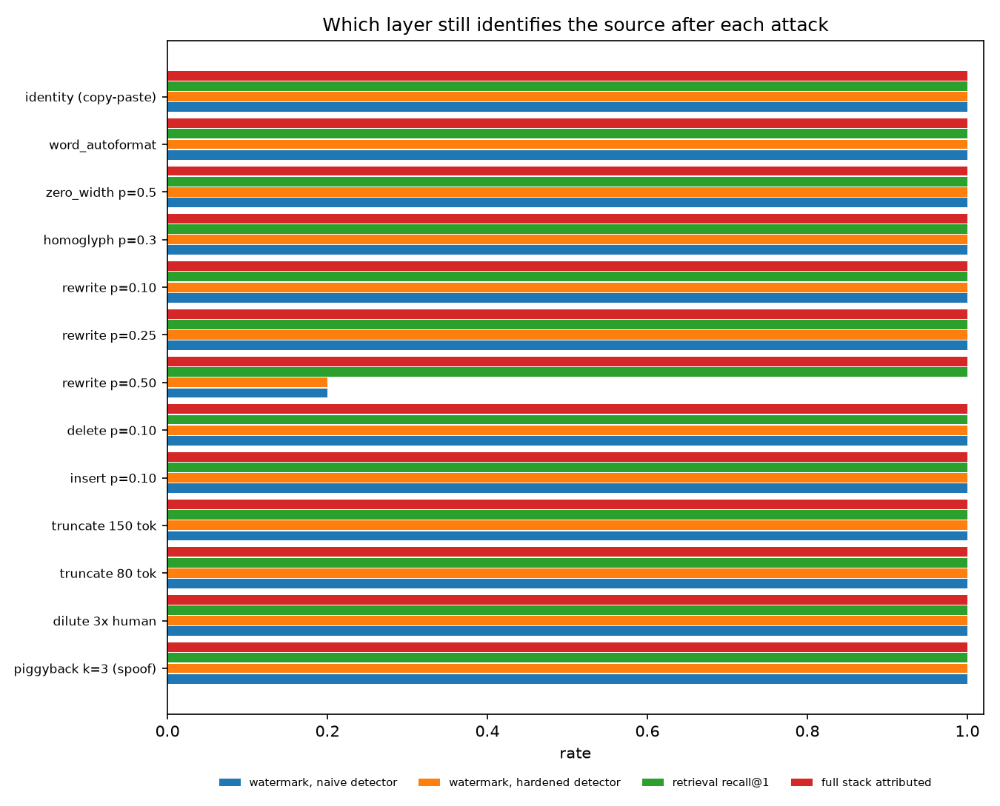
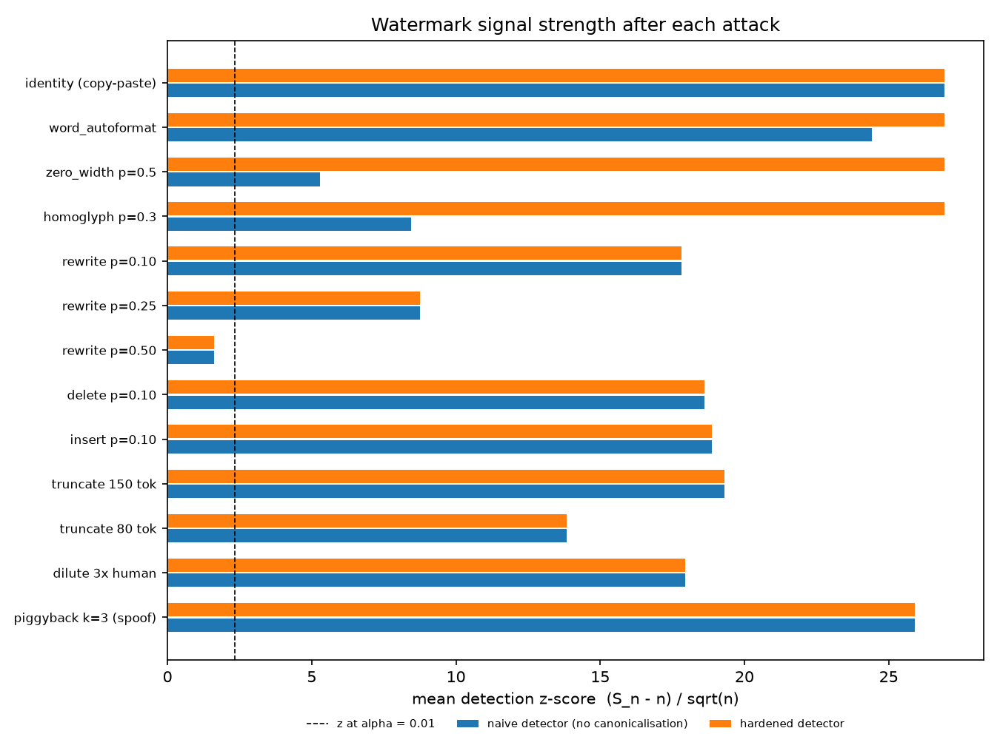
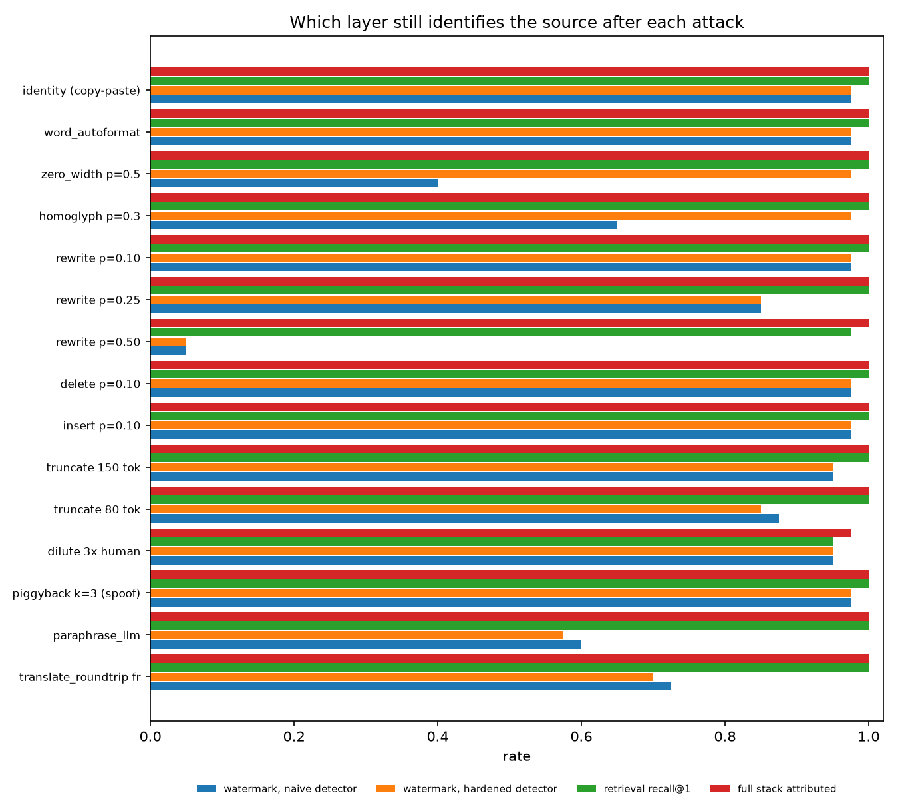
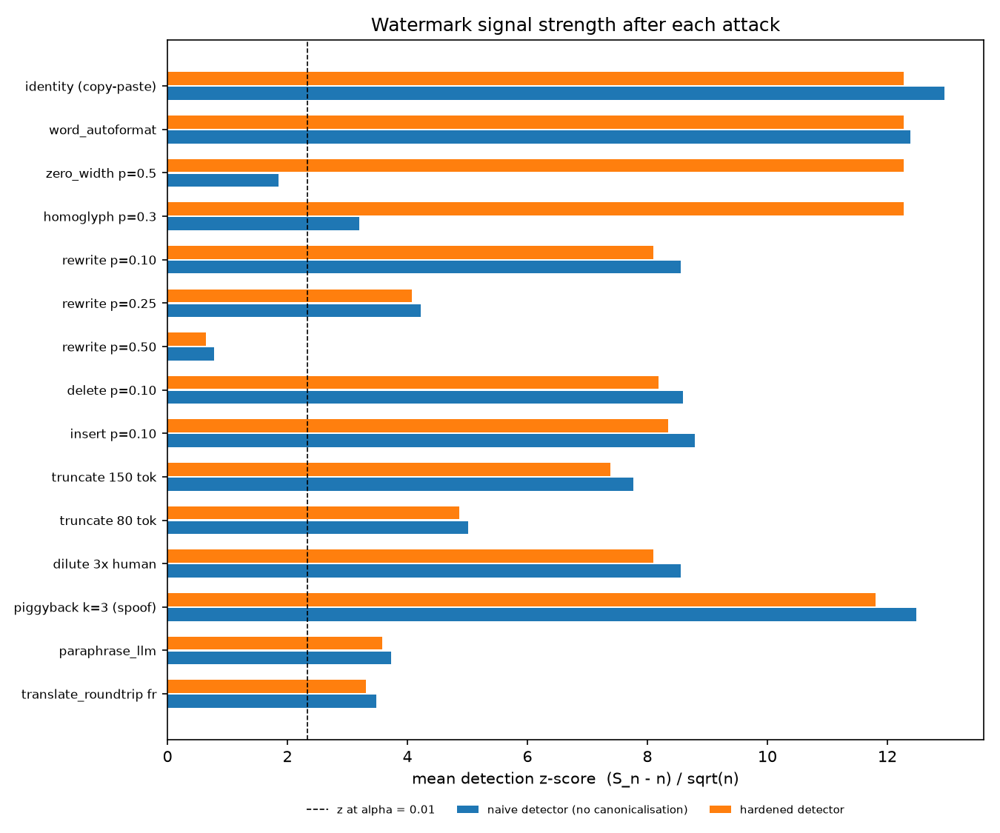

# Watermark: a reference defense stack for LLM text provenance

OpenAI gave its models an invisible stamp. I wanted to know what it can survive, what kills it, and what you have to build around it so it still earns its keep when it fails. So I built a test copy and attacked it in the open. Everything here runs with one command, checks its own math before it prints a number, and shows its work.

What is in the box:

1. a **textGrain-style watermark** (keyed vocabulary blocks plus an entropy-budgeted optimal-transport coupling, the scheme OpenAI described on 5 October 2026 for EU AI Act Article 50 compliance),
2. a **hardened detector** (canonicalisation against tokenizer-desync tricks, Gamma-calibrated p-values, sliding-window localisation against dilution),
3. a **semantic retrieval index** (FAISS, multilingual sentence embeddings): the layer that survives paraphrase and translation,
4. a **signed-output registry** (Ed25519 over canonical hashes, SQLite): the layer that turns "watermark present" into "this exact text" or "this text minus these edits",
5. an **attack harness** that runs every attack through every layer and reports which layer still names the source.

```
                 generate ──► textGrain sampler ──► text ──► register (hash+sign) ──► registry.sqlite
                                     │                           └─► embed sentences ──► FAISS index
                                     ▼
   attacks: copy-paste · autoformat · zero-width · homoglyph · rewrite · delete · insert
            truncate · dilute · piggyback spoof · [hf] paraphrase · translate round-trip
                                     ▼
   verdicts: watermark p-value (naive vs hardened) · segment localisation
             retrieval recall@1 · registry exact / tampered (+diff) / unknown
```

One thing up front: OpenAI built the watermark. I did not. I built a copy of the published design so anyone can look inside it instead of taking a company's word for it.

## Run it

```bash
git clone https://github.com/yobiebenjamin/Watermark && cd Watermark
./run.sh                 # offline toy model, a few minutes on one CPU: venv, install, pytest, full sweep
./run.sh toy --quick     # smoke sweep, under a minute
```

Needs Python 3.10 or newer (the newest `python3.x` on `PATH` is picked for you) and PyPI on the first run. No model download, no GPU, no API key, no account with anybody.

With a real model (CUDA or Apple Silicon MPS is picked for you; models download from Hugging Face on first run; the committed run below took 45 minutes on an M4 Max):

```bash
./run.sh hf --model Qwen/Qwen2.5-1.5B-Instruct \
            --embedder paraphrase-multilingual-MiniLM-L12-v2 \
            --llm-attacks --n 40 --tokens 400
```

`--llm-attacks` adds the two attacks that actually matter: an unwatermarked instruct model paraphrasing the output, and a French round-trip translation.

Every run writes `results/<backend>-<timestamp>/report.md`, `report.json`, `roc.png`, `tpr.png`, `zscore.png`, plus the retrieval index, the registry database and the signing key, so `textgrain-ref verify` can be pointed at it afterwards.

Piece by piece:

```bash
KEY=$(textgrain-ref keygen)
textgrain-ref generate --key-hex $KEY --prompt "It was a truth universally acknowledged" --tokens 200 > wm.txt
textgrain-ref detect   --key-hex $KEY --file wm.txt            # {"p_value": ..., "z_score": ..., "detected": true}
textgrain-ref localize --key-hex $KEY --file long_document.txt # watermarked segments with character spans
textgrain-ref verify   --out results/toy-<timestamp> --file suspect.txt  # exact | tampered (+diff) | unknown (uses that run's index + registry)
```

## What the harness shows (toy backend, 30 × 300 tokens, α = 0.01, β = 0.5)

Full report: [`results/toy-beta0.5/report.md`](results/toy-beta0.5/report.md); a weaker-signal run at β = 0.2 is in [`results/toy-beta0.2/report.md`](results/toy-beta0.2/report.md).

| attack | tokens changed | TPR naive | TPR hardened | mean z naive | mean z hardened | retrieval R@1 | registry exact / tampered / unknown | stack attributed |
|---|---|---|---|---|---|---|---|---|
| identity (copy-paste) | 0% | 100% | 100% | 26.9 | 26.9 | 100% | 100 / 0 / 0 | 100% |
| word_autoformat | 0% | 100% | 100% | 24.4 | 26.9 | 100% | 100 / 0 / 0 | 100% |
| zero_width p=0.5 | 0% | 100% | 100% | 5.3 | 26.9 | 100% | 100 / 0 / 0 | 100% |
| homoglyph p=0.3 | 0% | 100% | 100% | 8.4 | 26.9 | 100% | 100 / 0 / 0 | 100% |
| rewrite p=0.10 | 16% | 100% | 100% | 17.8 | 17.8 | 100% | 0 / 100 / 0 | 100% |
| rewrite p=0.25 | 34% | 100% | 100% | 8.7 | 8.7 | 100% | 0 / 100 / 0 | 100% |
| rewrite p=0.50 | 73% | 20% | 20% | 1.6 | 1.6 | 100% | 0 / 0 / 100 | 100% |
| delete p=0.10 | 15% | 100% | 100% | 18.6 | 18.6 | 100% | 0 / 100 / 0 | 100% |
| insert p=0.10 | 13% | 100% | 100% | 18.9 | 18.9 | 100% | 0 / 100 / 0 | 100% |
| truncate 150 tok | 50% | 100% | 100% | 19.3 | 19.3 | 100% | 0 / 100 / 0 | 100% |
| truncate 80 tok | 73% | 100% | 100% | 13.8 | 13.8 | 100% | 0 / 100 / 0 | 100% |
| dilute 3× human | 54% | 100% | 100% | 17.9 | 17.9 | 100% | 0 / 100 / 0 | 100% (localisation IoU 0.73, found 100%) |
| piggyback k=3 (spoof) | 1% | 100% | 100% | 25.9 | 25.9 | 100% | 0 / 100 / 0 | 100% |

Null calibration on 60 passages (30 human, 30 unwatermarked model): analytic FPR 1.7% at α = 1%; the registry says `unknown` for 100% of human text. Same prompt and same key give distinct outputs 100% of the time (Gumbel-max would give 0%). Achieved entropy budget 0.464 of a requested 0.5.




Read the table as the threat model:

* **Copy-paste is a non-event.** The signal is the word sequence; docx to vi to anything keeps it. The registry says `exact`.
* **Tokenizer-desync tricks beat a naive detector** (z drops from 27 to between 5 and 8 with nothing visible changed) **and do nothing to the hardened one.**
* **Rewriting is the real attack.** Resample half the tokens and the watermark is at chance. Every edit costs `context_window + 1` scored positions, which is why the curve falls off a cliff. Only retrieval still finds the source.
* **Dilution hides the signal from the passage test** and not from localisation.
* **Piggyback spoofing beats the watermark** (a 3-token edit is still "detected", which is the whole point of the attack) and the registry catches it, returning `tampered` with the spans that moved.

The toy model has about 3.7 nats per token of entropy, two to three times a real instruct LLM, so these absolute rates are flattering. The ordering and the layer behaviour carry over. The real-model run below checks that claim. `bash results/reproduce.sh` regenerates both committed runs (seeded; identical up to floating-point differences between machines).

<!-- hf-table:start -->
## What the harness shows (real model: Qwen2.5-1.5B-Instruct, 40 × 400 tokens, α = 0.01, β = 0.5)

Full report: [`results/hf-20261013-074938/report.md`](results/hf-20261013-074938/report.md). Model `Qwen/Qwen2.5-1.5B-Instruct` on Apple Silicon (MPS, bf16), temperature 1, top-p 1; embedder `paraphrase-multilingual-MiniLM-L12-v2`; the two LLM-driven attacks use the same model, unwatermarked, as the attacker. Runtime 45 min on an M4 Max. `bash results/reproduce_hf.sh` regenerates it.

| attack | tokens changed | TPR naive | TPR hardened | mean z naive | mean z hardened | retrieval R@1 | registry exact / tampered / unknown | stack attributed |
|---|---|---|---|---|---|---|---|---|
| identity (copy-paste) | 0% | 98% | 98% | 13.0 | 12.3 | 100% | 100 / 0 / 0 | 100% |
| word_autoformat | 0% | 98% | 98% | 12.4 | 12.3 | 100% | 100 / 0 / 0 | 100% |
| zero_width p=0.5 | 0% | 40% | 98% | 1.8 | 12.3 | 100% | 100 / 0 / 0 | 100% |
| homoglyph p=0.3 | 0% | 65% | 98% | 3.2 | 12.3 | 100% | 100 / 0 / 0 | 100% |
| rewrite p=0.10 | 11% | 98% | 98% | 8.6 | 8.1 | 100% | 0 / 100 / 0 | 100% |
| rewrite p=0.25 | 31% | 85% | 85% | 4.2 | 4.1 | 100% | 0 / 100 / 0 | 100% |
| rewrite p=0.50 | 70% | 5% | 5% | 0.8 | 0.6 | 98% | 0 / 100 / 0 | 100% |
| delete p=0.10 | 14% | 98% | 98% | 8.6 | 8.2 | 100% | 0 / 100 / 0 | 100% |
| insert p=0.10 | 11% | 98% | 98% | 8.8 | 8.3 | 100% | 0 / 100 / 0 | 100% |
| truncate 150 tok | 48% | 95% | 95% | 7.8 | 7.4 | 100% | 10 / 90 / 0 | 100% |
| truncate 80 tok | 70% | 88% | 85% | 5.0 | 4.9 | 100% | 2 / 98 / 0 | 100% |
| dilute 3× human | 55% | 95% | 95% | 8.6 | 8.1 | 95% | 0 / 95 / 5 | 98% (localisation IoU 0.73, found 95%) |
| piggyback k=3 (spoof) | 2% | 98% | 98% | 12.5 | 11.8 | 100% | 0 / 100 / 0 | 100% |
| paraphrase_llm | 53% | 60% | 57% | 3.7 | 3.6 | 100% | 0 / 100 / 0 | 100% |
| translate_roundtrip fr | 44% | 72% | 70% | 3.5 | 3.3 | 100% | 2 / 98 / 0 | 100% |

Null calibration on 80 passages (40 human, 40 unwatermarked model): analytic FPR 0.0% at α = 1% (naive 0.0%); registry says `unknown` for 100% of human text. Same prompt + same key gives distinct outputs 100% of the time. Achieved entropy budget 0.450 of a requested 0.5; 4.2% of positions masked as repeated contexts.



<!-- hf-table:end -->

Read it against the toy table:

* **Half the signal.** A real instruct model at temperature 1 has far less entropy than the toy LM: mean z on untouched text is 12 instead of 27, and 98% rather than 100% of 400-token outputs clear α = 0.01 (4.2% of positions are masked as repeated contexts, three times the toy rate; real text repeats itself). The null is cleaner than the model assumes: none of the 80 unwatermarked passages crossed the threshold, and the empirical 1% point on −log10 p (1.42) sits below the analytic one (2.0), so the Gamma test is conservative on real text.
* **Tokenizer-desync tricks now bite.** With half the signal, zero-width and homoglyph insertion take the naive detector to 40% and 65% (z 1.8 and 3.2) with no visible change to the text; canonicalisation puts it back to 98%. On the toy model they only dented z.
* **The rewrite cliff is steeper.** Resampling 11% of tokens costs a third of the signal (z 12 to 8), 31% brings detection down to 85%, 70% is chance (5%). Retrieval still finds 98% of the sources and the registry says `tampered`.
* **The two attacks that matter take the watermark to 57% and 70%.** LLM paraphrase and the French round trip change about half the tokens and leave z around 3.5, and the attacker here is the same 1.5B model rewriting its own output; a stronger paraphraser will do more damage. The multilingual retrieval index finds the source 100% of the time in both cases and the registry says `tampered` with the diff, so the stack still attributes every sample. Every one of those attributions rests on the provider having kept an index of everything it generated. That is the layer map the toy run predicted, now measured.
* **Dilution and spoofing behave as before.** Localisation finds the watermarked span in 95% of diluted documents (IoU 0.73); one of 40 escaped retrieval. A 3-token piggyback edit is still "detected" at z 11.8 and the registry catches it 100% of the time.

`bash results/reproduce_hf.sh` regenerates the run and this section (`results/readme_table.py` renders the table from `report.json`). The committed run used `temperature 1.0`, `top-p 1.0`; sweep `--beta` and `--top-p` to move along the quality/detectability trade-off.

## Documentation

* [`docs/NARRATIVE_PLAIN_ENGLISH.md`](docs/NARRATIVE_PLAIN_ENGLISH.md): the whole project for a reader with no technical background. Problem, what I set out to do, how it works, what I found, why it matters.
* [`docs/NARRATIVE_TECHNICAL.md`](docs/NARRATIVE_TECHNICAL.md): the same story with the mechanisms, the numbers and the limits spelled out.
* [`docs/DESIGN.md`](docs/DESIGN.md): the mathematics of embedding, detection, hardening and the two extra layers, and what each test checks.
* [`docs/THREAT_MODEL.md`](docs/THREAT_MODEL.md): attacks ranked by cost, who uses them, and which layer holds against each.
* [`docs/USAGE.md`](docs/USAGE.md): CLI reference, Python API, Hugging Face backend, how to read the report, how to extend the harness.

## Repository layout

```
textgrain_ref/
  prf.py          keyed PRF: HMAC seeds, random-access partition / cost table / column
  ot.py           entropy-budgeted block OT (log-domain Sinkhorn, lambda calibration, marginal correction)
  watermark.py    TextGrainSampler, temperature/top-p, backend-agnostic generate()
  canonicalize.py NFKC + zero-width + confusables + typography normalisation
  detector.py     Gamma(n,1) test, p-values, empirical thresholds, sliding-window localisation
  retrieval.py    sentence splitting, hashing / sentence-transformers embedders, FAISS index
  registry.py     Ed25519-signed canonical-hash registry, exact / tampered / unknown verdicts, token diffs
  attacks.py      attack library and the default sweep
  harness.py      end-to-end evaluation, report.md / report.json / plots
  cli.py          demo · generate · detect · localize · verify · keygen
  lm/ngram.py     offline toy trigram LM (interpolated absolute discounting)
  lm/hf.py        Hugging Face backend with KV-cached watermarked decoding + instruct helpers
tests/test_stack.py   15 tests: PRF, OT marginals/budget, unbiasedness + entropy identity,
                      Exp(1) null (KS), FPR control, detection power, wrong key, diversity,
                      canonicalisation vs desync attacks, localisation, retrieval, registry, signatures
data/             public-domain Austen texts for the toy LM and the human-text pool (fetch_corpus.sh)
results/          committed reports and plots from the three reference runs
                  (toy β=0.5, toy β=0.2, Qwen2.5-1.5B-Instruct) + reproduce.sh, reproduce_hf.sh,
                  readme_table.py (renders the README table from a run's report.json)
docs/             NARRATIVE_PLAIN_ENGLISH.md, NARRATIVE_TECHNICAL.md, DESIGN.md, THREAT_MODEL.md, USAGE.md
```

## Production notes (what a reference implementation leaves out, on purpose)

* **PRF.** Seeds come from HMAC-SHA256; per-element expansion uses splitmix64, a mixer, not a cipher. Replace it with AES-CTR or ChaCha20 keyed by the HMAC output.
* **Keys.** The demo derives a deterministic key from `--seed` so runs reproduce. Use `textgrain-ref keygen` (or an HSM), one key per model, version-tagged so rotation does not orphan old content.
* **Calibration.** The analytic null assumes independence across contexts; OpenAI's own report says a fixed deployed key needs empirical calibration per language and domain. The harness prints an empirical threshold from the null sample; with only 60 null passages that quantile is dominated by its single largest value, so use a large null set before you trust an operating point.
* **Oracles.** The detector, the retrieval query endpoint and the registry verifier are all oracles for an adaptive attacker. Gate them, rate-limit per account, return calibrated verdict bands rather than raw scores.
* **Coverage.** Nothing here helps against text from models that were never watermarked, against deterministic decoding (temperature 0 leaves no entropy to tilt), or against low-entropy domains such as code. Only retrieval covers those.
* **Privacy.** The retrieval index stores embeddings of every output. Salt, shard per tenant, bound retention, and treat it as personal data where the law says it is.

## References

* OpenAI, *textGrain: Entropy-Calibrated Watermarking for Language Model Text*, technical report, 5 October 2026.
* Aaronson (2023) Gumbel-max watermark; Kirchenbauer et al. (2023) green-list watermark; Dathathri et al. (2024) SynthID-Text; Kuditipudi et al. (2024) distortion-free watermarks.
* Christ, Gunn, Zamir (2024) undetectable watermarks; Christ & Gunn (2024) pseudorandom codes.
* Zhang et al. (2024) *Watermarks in the Sand* (impossibility of strong watermarking).
* Krishna et al. (2023) paraphrasing evades detectors, retrieval is an effective defense.
* Jovanović et al. (2024) watermark stealing; Pang et al. (2024) no free lunch in LLM watermarking.
* Altschuler, Niles-Weed, Rigollet (2017) Sinkhorn rounding; Cuturi (2013) Sinkhorn distances.

## Blog

Two posts on what this study found, in [`blog/`](blog/) as Markdown and Word (CC BY-NC 4.0, see License below): [Why an Invisible Stamp Won't Keep AI Safe](blog/01-why-an-invisible-stamp-wont-keep-ai-safe.md) (for everyone) and [Inside OpenAI's Watermark: What the Study Found](blog/02-inside-openais-watermark.md) (the technical companion, with the code). Where the argument goes from here is [A Multi-Layer Approach to AI Safety](https://github.com/YobieBenjamin/hardware-and-silicon/blob/main/blog/01-a-multi-layer-approach-to-ai-safety.md) and the series *The Chip That Says No* in the same repository.

## License

Source-available, not open source. Copyright (c) 2026 Yobie Benjamin. Software is licensed under the PolyForm Noncommercial License 1.0.0 ([LICENSE.md](https://github.com/YobieBenjamin/autonomic-graph-regulation/blob/main/LICENSE.md)); documentation, data and figures under CC BY-NC 4.0 ([LICENSE-DOCS.txt](https://github.com/YobieBenjamin/autonomic-graph-regulation/blob/main/LICENSE-DOCS.txt)). Attribution is required for any use in whole or in part ([NOTICE](https://github.com/YobieBenjamin/autonomic-graph-regulation/blob/main/NOTICE)); commercial use requires a separate license. See [LICENSING.md](https://github.com/YobieBenjamin/autonomic-graph-regulation/blob/main/LICENSING.md) for scope and contact, and [CITATION.cff](https://github.com/YobieBenjamin/autonomic-graph-regulation/blob/main/CITATION.cff) to cite this work.
